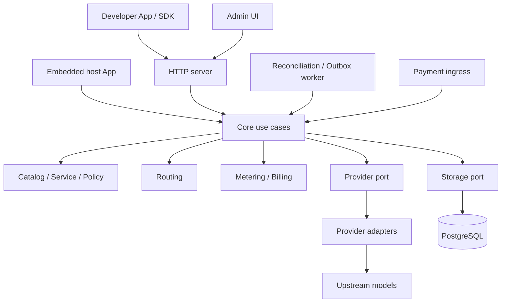

# SuperRouter 技術架構

> 實作進度：本文件保留完整目標設計；P1 採用的收斂決策見 [ADR 0001](adr/0001-p0-baseline.md)，已實作 API 見 [OpenAPI](generated/openapi.json)，驗證範圍見 [P1 紀錄](P1_VALIDATION.md)。

版本：0.1 · 2026-11-04 · 設計提案，未實作

依據：[PRD](PRD.md)。本文件把產品需求轉為可實作的技術邊界；選型是建議基線，尚未代表套件發佈、相容性測試或效能承諾。

## 1. 架構決策

| 決策 | 建議基線 | 理由／限制 |
| --- | --- | --- |
| 交付 | TypeScript 核心套件、Node.js server、HTTP SDK | 同一核心可嵌入伺服器 App；不把可攜性承諾擴大到瀏覽器或 edge runtime |
| 部署 | 模組化單體，加獨立 worker 入口 | 先確保帳務交易完整，不先引入跨服務交易 |
| 持久化 | PostgreSQL reference storage adapter | 帳本、預留與租戶邊界需交易及約束；其他 storage adapter 必須通過同一契約測試 |
| 工作佇列 | 資料庫 outbox 與可租用的 jobs | P1 不要求外部 broker；傳遞至少一次，以冪等處理收斂 |
| 快取 | 可選，僅加速設定與健康讀取 | 不作餘額、撤銷、預留或結算的唯一依據 |
| API | 自有 `/v1` Service API 優先 | 相容第三方 API 的轉譯層另定範圍，不宣稱完全相容 |
| UI | 後續管理 App，透過同一管理 API | 框架在 P2 前選定，核心不依賴 UI |
| 商業整合 | Payment port 與 provider-specific adapter | 不在核心寫死付款服務商或商戶模式 |

實際 runtime／依賴版本、付款服務商、首兩家 Provider 與授權條款仍需在實作 kickoff 定案。Provider 名稱與 adapter 行為應以當時官方規格驗證；本文件不指定尚未驗證的模型價格或 API 能力。

## 2. 模組與依賴

| 預計路徑 | 職責 | 禁止依賴 |
| --- | --- | --- |
| `packages/contracts` | 資料型別、錯誤、事件與 schema | HTTP server、資料庫 driver |
| `packages/core` | 發布、選路、預留、執行、結算等 use cases | 具體 Provider SDK、UI、HTTP framework |
| `packages/adapters/storage-postgres` | Repository、交易、jobs、outbox | UI、Provider 呼叫 |
| `packages/provider-*` | 能力宣告、轉換、串流、用量正規化 | 客戶扣款與售價計算 |
| `packages/sdk` | HTTP client、串流事件、typed errors | 伺服器 secrets、直接資料庫存取 |
| `backends/typescript/server` | Auth、HTTP、SSE | 重複實作帳務規則 |
| `apps/worker` | jobs、租約、對帳、事件交付 | 繞過 core 任意改餘額 |
| `apps/console` | 管理體驗 | 直接存取 Provider credentials |

這些為後續程式目錄，不在文件階段產生空 package manifest。嵌入模式由宿主注入 Storage、SecretStore、Clock、ProviderRegistry 與可信 Principal；宿主負責驗證使用者，core 仍驗證其資源範圍。不可把前端傳入的 workspace/customer 當成可信 Principal。

## 3. 三種帳務關係

Cloud Developer pays 同時可能涉及三本互相獨立的業務帳：

1. SuperRouter 向 Provider 購買供應的成本紀錄。
2. SuperRouter 向開發者收取的平台用量費／平台 credits。
3. 開發者按其 Service 價目向終端 customer 扣款。

第 2 與第 3 項不得混成一筆；免費提供給 customer 的 App 仍可能需要支付平台費。Self-host BYOK 沒有第 2 項，但必須保留供應成本預算；其 Provider 發票由部署者與 Provider 結算，不假裝已由 SuperRouter 付款。

每個 request 建立 billing legs：`platform_sale` 與可選 `customer_sale`，各自固定帳戶、價目、資產與預留。另有 `provider_spend` budget hold，僅控制成本，不當成 customer 收費。Cloud 同一資料庫內各 leg 原子預留／結算；不得任一 leg 成功後就發送、再補檢查其他 leg。跨部署供應留到後續，不在 P1/P2 做分散式錢包交易。

## 4. 執行流程與交易邊界

1. 驗證 key、租戶、environment、customer 綁定、Service scope 與限流。
2. 解析已發布 Service、tier、policy、售價及供應價格版本；固定版本引用與設定摘要。
3. 建立候選集合，套硬限制，取得健康快照，估算上界並排名。所有未知必要能力視為不符合。
4. **交易 A**：建立 request／冪等紀錄；依固定順序鎖定帳戶、buckets、預算；原子預留所有 billing legs 與供應預算；提交。不得在交易內做網路呼叫。
5. **交易 B**：重新驗證 credentials／connection 未被停用、候選仍合法及剩餘預算；建立帶 dispatch token 的 Attempt 並提交。
6. 呼叫 Provider，處理串流背壓與取消，保存必要執行 metadata／usage。第一個對客戶輸出的內容交付後，禁止透明 fallback。
7. 失敗且尚未交付輸出時，只有明確可重試的錯誤才在剩餘總預算內重新選路。上游是否執行不明，先進入 unknown，不盲目重送。
8. **交易 C**：保存 Attempt 結果／usage revision；建立各 leg 的唯一 settlement、balanced journal、釋放剩餘 hold，更新 request billing state，寫 outbox；一次提交。
9. Worker 非同步交付事件、更新聚合資料及對帳。報表最終一致；餘額及扣款必須強一致。

Request execution status 與 billing status 分開；完成輸出不等於帳務已確認。上游網路呼叫無法與資料庫做單一原子交易，dispatch 後 crash 必須保留未知狀態，不能宣稱整體 exactly-once。

## 5. Provider port

每個 adapter 必須實作下列概念契約；此表不是已發佈 SDK：

| 操作 | 輸入／輸出 |
| --- | --- |
| `describeCapabilities` | 模型、區域、streaming、tools、結構化輸出、context、可接受參數 |
| `estimateUsageBound` | 輸入與輸出上限 → 保守 token／成本上界；無法估算則拒絕有限預算請求 |
| `invoke` | 正規化請求、credentials handle、abort signal、dispatch token → 正規化事件 |
| `normalizeUsage` | 原始 usage → 互斥計費 meters、來源、可信狀態、adapter version |
| `lookupOutcome` | 可選；上游 request ID → 結果／usage／unsupported |
| `classifyError` | retryable、definitive／unknown、是否已交付輸出 |

原始 Provider error 在回傳前遮罩。僅對有明確文件與測試的 Provider 使用其冪等鍵或結果查詢能力；本地 dispatch token 不自動等於上游去重。

## 6. Routing 演算法

候選先符合 model identity、能力、資料地區與標籤、價格上限、availability、剩餘成本預算。Specific 模式只保留同一 model identity；跨 tier 僅在顯式 allowlist 中發生。

在剩餘集合計算 `score = Σ(weight × normalized_metric)`，一律轉為越高越好，權重非負且總和為 1。初期採版本化政策的固定上下界 clamp normalization，避免候選增減導致尺度難以追查；相同分數以穩定 offering ID 排序。成本反向、延遲反向，成功率／品質正向。品質是指定任務的評級，不自動從使用者內容推測。

健康快照包含觀測窗口、樣本數、時效及來源。缺值採政策明示的保守分數或排除，並記錄原因。Circuit breaker 為 offering／區域維度；half-open 探測限制併發。實際 dispatch 再檢查停用／撤銷與安全限制；已固定的版本不允許繞過緊急封鎖。

Dry-run 使用同一純選路邏輯但不預留、不發送付費探測；回傳快照時間及「不保證執行時仍可用」。Health 探測若會花費，必須有獨立營運預算。

## 7. 帳務與故障恢復

- 可用額度由持久化帳本投影及有效 holds 決定；快取不足以批准請求。
- Pending customer settlement 與 pending provider cost 可分開：未交付結果且按契約免費時，釋放 customer hold；供應成本仍可待對帳。
- Hold deadline 不是自動釋放授權。先檢查 Attempt 是否停止、是否 unknown；unknown 由 worker 查詢上游或人工裁決，設定下一次檢查及告警。
- 無法取得最終 usage 時，不將估算當已確認。經受權操作可用已確認用量結算或豁免，記錄證據與理由；最終 customer settlement 不再默默追加扣款。
- 後到的成本修正作追加 revision；退款／貸記以 correction journal 呈現，不改歷史。
- Worker 租約帶 fencing generation；舊 worker 不得更新新 generation 的執行紀錄。這只限制本地寫入，不能撤回上游已收到的請求。
- Outbox 與業務資料同交易寫入；投遞至少一次。接收端依 event ID 去重，死信可查詢與受控重送。

## 8. 安全與部署

Cloud 僅平台 operator 可建立平台 supply connection；workspace 管理 API 拒絕上游 credentials 與任意 upstream URL。Self-host 的 BYOK 僅限有 connection 管理權限的伺服器端操作者。

SecretStore 保存加密 secret 或外部 secret reference；DB 只保存 reference 與輪替 metadata。API keys 僅初次顯示，保存可辨識前綴與安全 hash。管理權限分為 service admin、billing admin、operator、viewer；推論 key 無授額／調價權。

Provider endpoints 與 webhook destinations 都有 SSRF／egress 控制；禁止租戶以自訂 URL 存取 metadata 或內部網路，self-host 的私有端點需部署者明確 allowlist。Log 預設不含內容／secrets，debug opt-in 也須保留期與遮罩。

Self-host 最小部署為 server、worker 與 DB；embedded host 必須承擔 worker lifecycle 或啟動獨立 worker。沒有 worker 的 demo 不得宣稱具備可靠對帳。Cloud 可水平擴展 server／worker，共用 DB 約束；管理面不可用時仍可讀取已發布版本，帳務 DB 不可用則拒絕新付費執行。

備份需要同時涵蓋帳本、設定與解密金鑰的可恢復性；還原演練須防止重播付款造成重複授額。部署採相容 schema 的 expand／migrate／contract，禁止回滾後失去新帳本可讀性。

## 9. 可觀測性與待驗證事項

所有 traces 連結 request、attempt、settlement、event ID；依租戶權限顯示成本及供應細節。指標包含預留拒絕、unknown aging、對帳差異、outbox backlog、額外處理延遲與 Provider 延遲。

P0 尚需落定版本矩陣、首兩個 adapters、計費精度及 P2 SLO。P1 必須做交易競爭、dispatch crash、stream interruption、重送與跨租戶測試；完整工程拆分見 [實作計畫](IMPLEMENTATION_PLAN.md)。
